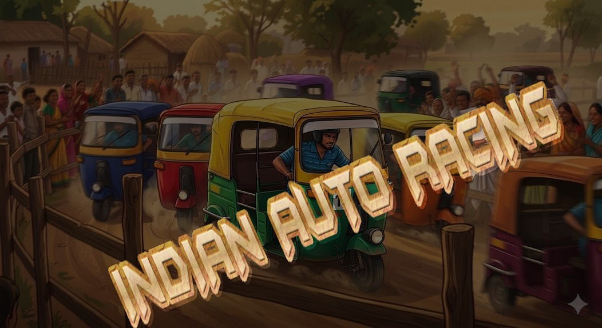
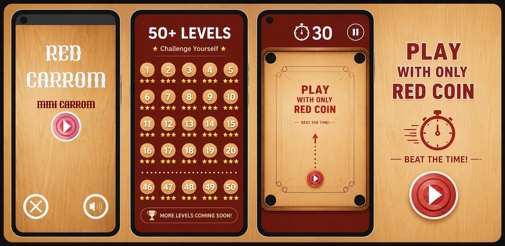
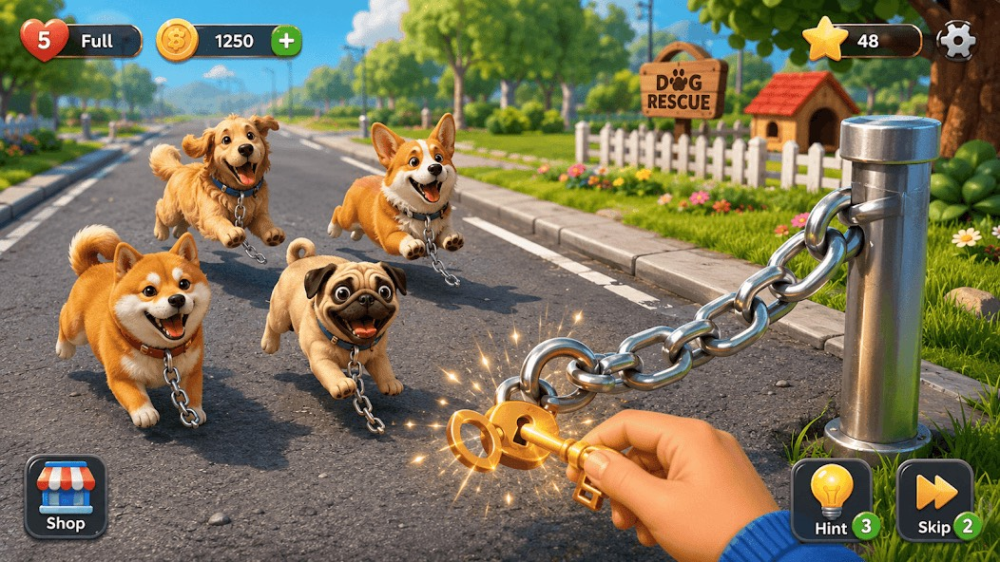
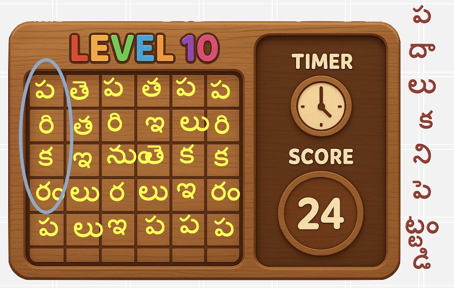
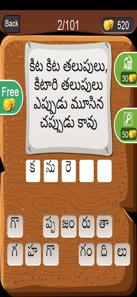
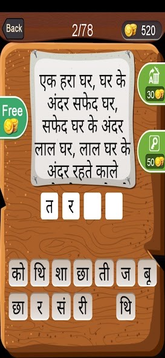
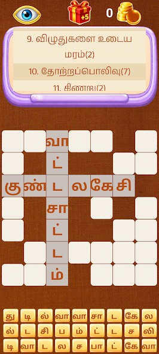
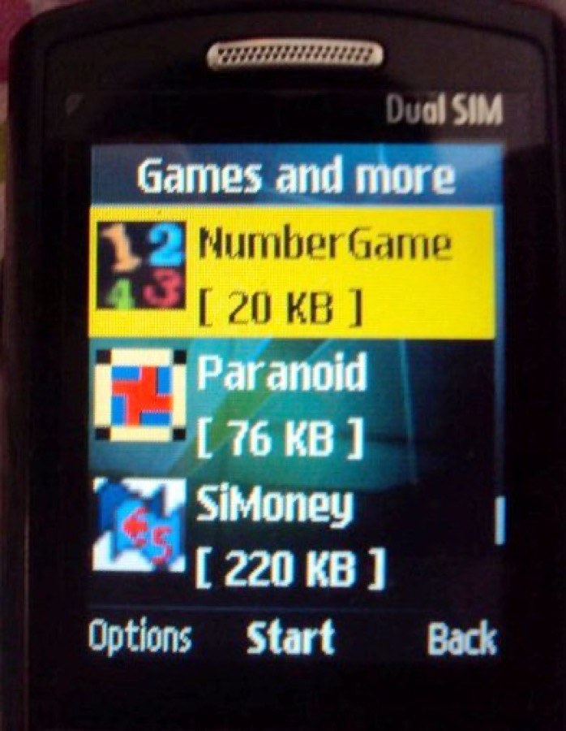
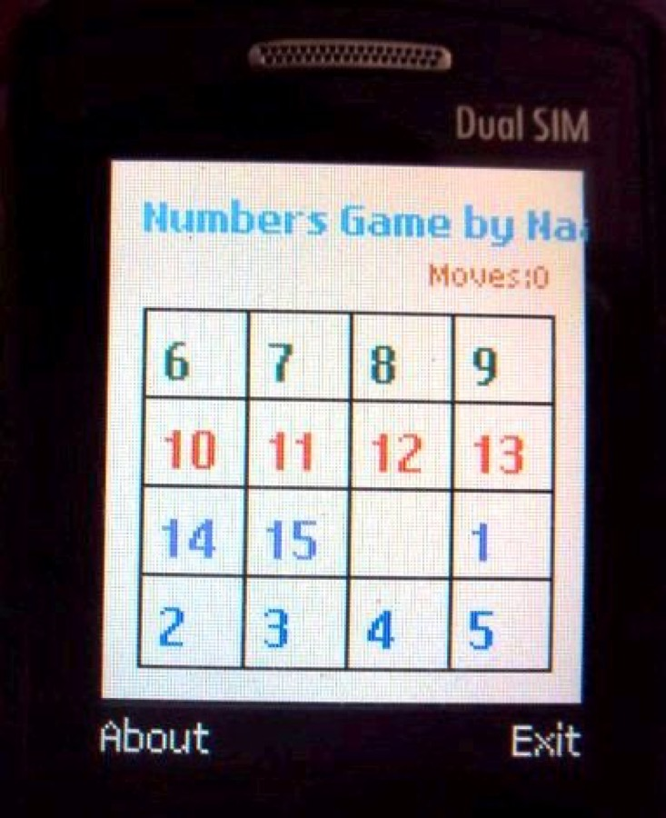

<h1 align="center">Nagender Bojjawar</h1>

  <strong>Senior Software Engineer · SDET · AI Model Evaluator</strong> 
  Hyderabad, India

  <a href="mailto:naagender.b@gmail.com">naagender.b@gmail.com</a>
  &nbsp;·&nbsp;
  
  &nbsp;·&nbsp;
  <a href="https://www.linkedin.com/in/nagender-bojjawar-8536436">LinkedIn</a>
  &nbsp;·&nbsp;
  <a href="https://play.google.com/store/apps/dev?id=4910529798456608604">Google Play</a>
  &nbsp;·&nbsp;
  <a href="./Nagender_Bojjawar_Resume.docx">Resume</a>

  
  
  
  
  
  
  
  
  
  
  
  

Senior software engineer and SDET with 18+ years across software engineering, quality assurance, test automation, and enterprise CI/CD. I design automation frameworks, build Jenkins and GitLab pipelines, and automate Android and iOS. I also evaluate AI model output for correctness, instruction following, and reasoning quality.

Master of Computer Applications (MCA), Computer Engineering, Osmania University.

---

## Experience

<table>
<tr>
<td width="50%" valign="top">

<b>AI Model Evaluator</b> · Remote Jun 2026 – Sep 2026

<ul>
<li>Evaluating AI responses for correctness, relevance, and instruction following</li>
<li>Assessing reasoning quality and usefulness of technical output</li>
<li>Reviewing programming-oriented output for logic gaps</li>
</ul>
</td>
<td width="50%" valign="top">

<b>Senior Software Engineer</b> · Hyderabad Jan 2019 – Feb 2026

<ul>
<li>Pipeline orchestration: upstream and downstream pipelines across modules</li>
<li>Automation framework for Android and iOS, built from scratch</li>
<li>Testing pipelines and automation for Universal ZTNA (UZTNA)</li>
<li>BIG-IP APM testing, automation, and bug verification</li>
<li>Mentoring automation engineers and team knowledge transfer</li>
</ul>
</td>
</tr>
<tr>
<td width="50%" valign="top">

<b>Senior SDET</b> · Hyderabad May 2015 – Jan 2019

<ul>
<li>Automation strategy for the Lifion platform</li>
<li>Visual regression testing framework, built from scratch</li>
<li>Raised automation coverage for platform changes and sprint stories</li>
<li>Collaboration with ADP Innovation Labs, New York</li>
</ul>
</td>
<td width="50%" valign="top">

<b>Senior QA Engineer</b> · Hyderabad Jun 2011 – May 2015

<ul>
<li>QA and automation ownership for Nimsoft Asset Management</li>
<li>QA process definition from the early stages of the product</li>
<li>Diagnostic automation for post-production and release testing</li>
<li>Star Performer award, six times</li>
</ul>
</td>
</tr>
<tr>
<td width="50%" valign="top">

<b>SDET</b> · Hyderabad Oct 2010 – Jun 2011

<ul>
<li>Manual testing and automation ideas for product testing</li>
<li>Pega 6.0 certification</li>
</ul>
</td>
<td width="50%" valign="top">

<b>Software Engineer</b> · Hyderabad Dec 2005 – Jun 2010

<ul>
<li>Regression testing and development on the internal CA Portal</li>
<li>Integrations across Quality Center, Jira, and Service Desk</li>
<li>“Going Above and Beyond” award, seven times</li>
<li>Selected for a CA Innovation Meeting with the CEO</li>
</ul>
</td>
</tr>
</table>

## How I work

Automation strategy and architecture · technical troubleshooting · mentoring · cross-team collaboration · process improvement · networking fundamentals · continuous learning

**Also in the toolkit:** Postman, Microsoft SQL Server, Ansible, Apache, Git, Perforce, Docker, Kubernetes, Terraform, visual regression testing, and Android, web, and desktop workflows.

---

## Hobbies

### Game development

I design and publish original Android games as [BNGSAPPS on Google Play](https://play.google.com/store/apps/dev?id=4910529798456608604). Tap a tile to open the game.

<table>
<tr>
<td width="25%" align="center" valign="middle"></td>
<td width="25%" align="center" valign="middle"></td>
<td width="25%" align="center" valign="middle"></td>
<td width="25%" align="center" valign="middle"></td>
</tr>
<tr>
<td width="25%" align="center" valign="middle"></td>
<td width="25%" align="center" valign="middle"></td>
<td width="25%" align="center" valign="middle"></td>
<td width="25%" align="center" valign="middle"></td>
</tr>
<tr>
<td width="25%" align="center" valign="middle"></td>
<td width="25%" align="center" valign="middle"></td>
<td></td>
<td></td>
</tr>
</table>

The same Play developer page also includes learning and reading apps, including Class 2 and 3 Kids Maths, GD Constable preparation, Devotional Stotras in Telugu, and Learn Rudram.

### Symbian games

Before Android, I shipped small games for Symbian phones: **NumberGame**, **Paranoid**, and **SiMoney**.

<table>
<tr>
<td width="50%" align="center"></td>
<td width="50%" align="center"></td>
</tr>
</table>

### Alexa skills

I have also built Amazon Alexa skills, designing voice interactions on top of the same habit of shipping small products people can actually open and use.

---

## Education

**Master of Computer Applications (MCA), Computer Engineering**  
Osmania University, Hyderabad · Aug 2001 – Oct 2004

---

  <a href="./Nagender_Bojjawar_Resume.docx"><strong>Download resume</strong></a>
  &nbsp;·&nbsp;
  <a href="mailto:naagender.b@gmail.com">Email</a>
  &nbsp;·&nbsp;
  <a href="https://www.linkedin.com/in/nagender-bojjawar-8536436">LinkedIn</a>
  &nbsp;·&nbsp;
  <a href="https://play.google.com/store/apps/dev?id=4910529798456608604">Google Play</a>

